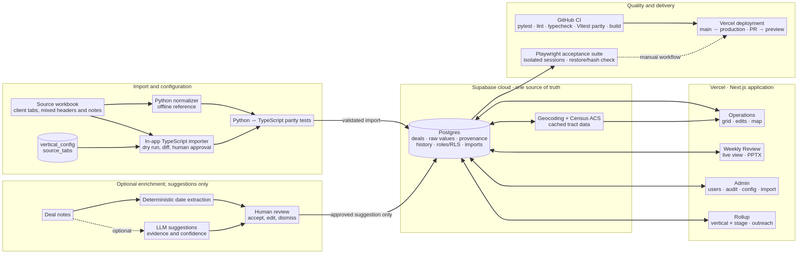
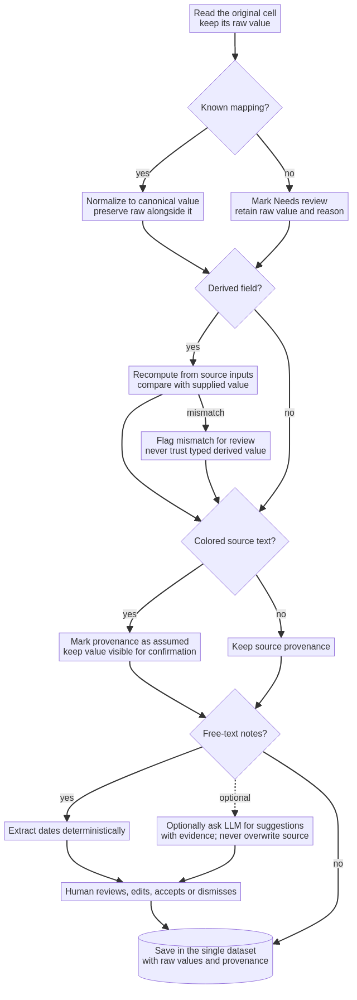

# Site Pipeline

## Start here: reviewer quick start

- **Live app:** [atoms-website-three.vercel.app](https://atoms-website-three.vercel.app)
- **Health:** [atoms-website-three.vercel.app/api/health](https://atoms-website-three.vercel.app/api/health)
- **CI:** [](https://github.com/DiegoOrtizRuiz/Atoms-Website/actions/workflows/ci.yml)
- **Process log:** [PROCESS_LOG.md](./PROCESS_LOG.md)
- **Implementation plan and production checklist:** [PLAN.md](./PLAN.md)

### Sign in

1. Open the live app and enter one of the demo email addresses below.
2. Enter the shared demo password from the submission email. The password is
   intentionally not included in this repository.
3. Select **Sign in**. Public sign-up is turned off, so reviewers do not need to
   create an account.

If you cannot sign in, check that the email and password were copied exactly.
If the problem continues, contact the person who provided the demo credentials.
The [health page](https://atoms-website-three.vercel.app/api/health) is a
technical status check; it is not another sign-in page.

| Demo account | What it demonstrates |
| --- | --- |
| `admin@demo.test` | User scopes, activity/usage dashboards, data health, role preview, CSV export |
| `leadership@demo.test` | Weekly Review and snapshot saving without deal-edit permissions |
| `lead.food@demo.test` | Food-vertical editing and assumption confirmation |
| `analyst.a@demo.test` | Client A editing scope; other clients remain read-only |
| `viewer@demo.test` | Read-only Operations and Weekly Review |

Each account has different permissions. For example, a read-only account can
still browse deals, but cannot save deal edits. If an edit is unavailable, sign
in with an account that has permission rather than trying to work around it.
All accounts use the password supplied in the submission email.

### First visit: where to go

After signing in, use the navigation on the left:

- **Operations** is the live deal list. Use it to find and, if your role allows,
  update a deal.
- **Weekly Review** is the meeting-ready summary of deals included in the
  weekly pipeline.
- **Rollup** summarizes deal counts by vertical and stage, time spent in a
  stage, and contact outreach.
- **My profile** shows your account role and recent activity.
- **Help** provides a plain-English guide to the app.
- **Admin** is visible only to administrators. It contains user management,
  activity, usage, and data-health information.

On a smaller screen, the navigation may be arranged across the top. Your name
and role appear near the bottom of the navigation area. Use the sign-out icon
beside your account when you are finished or want to switch demo accounts.

### Operations: find and review a deal

1. Open **Operations**. The number above the grid tells you how many deals are
   currently shown.
2. Use **Client**, **Vertical**, **Market**, or **Stage** to narrow the list.
   You can select more than one value. The filters work together; choose
   **Reset** to show everything again.
3. **Needs review** filters for records whose source status needs a person to
   review its mapping. **Has assumptions** finds values that are explicitly
   marked as unconfirmed.
4. Select a deal's address to open its details, including notes and the change
   history. A blank value is shown as an em dash (`—`), meaning it is unknown.
5. If you have edit permission, double-click an editable cell, make the
   change, and press **Enter** to save. Wait for the save confirmation. If the
   app says someone else edited the deal, the latest value has been reloaded;
   review it before trying again.

Italic text with a colored dot is marked as unconfirmed: amber means an
assumption and purple means an LLM suggestion. Use the cell's three-dot menu
to **Mark as assumption** or, if your role permits, **Confirm value**. A
confirmed value no longer has the unconfirmed styling. Calculated fields such
as **$/SF** are read-only because the app derives them from other values.

### Weekly Review: prepare for a meeting

1. Open **Weekly Review** and scan **Needs attention this week** for upcoming
   key dates, recent stage changes, and new deals.
2. Review the deal lists grouped by vertical. Select **Show all deals** to
   include deals that are not normally in the weekly view.
3. Select **Present** for a larger, presentation-style view. Use **Previous**
   and **Next**, or the arrow keys/space bar, to move between sections. Select
   **Exit** to leave presentation mode.
4. Select **Export PPTX** to download a PowerPoint deck based on the same
   weekly data shown on screen.
5. Administrators and Leadership can select **Save snapshot** to save the
   current weekly view. **Compare to snapshot** shows how it differs from the
   saved view.

The LLM enrichment script is optional and is not something reviewers need to
run. The app can show deterministic dates found in deal notes without an LLM
provider or API key.

### Rollup and Admin

- On **Rollup**, select a number in the vertical-by-stage table to open
  Operations filtered to those deals. Select a deal in **Longest in current
  stage** to open its details. Contact outreach percentages summarize the
  contact records.
- On **Admin**, use **Verticals & tabs** to review the live configuration and
  **Data import** to upload a workbook and inspect its dry-run diff. Do not
  apply an import during a reviewer tour. The overview, users, activity, and
  data-health tabs provide the administration and audit tools. **Online now**
  shows signed-in users currently viewing the app. Role preview changes the
  interface only; it does not grant another role's permissions.

### Try this in 2 minutes

1. Sign in as `viewer@demo.test` and open **Operations**. Filter by a vertical
   or stage, then select a deal address to see its notes and history.
2. Select the **Map** toggle. The map uses the same filters; when the map is
   available, select a marker for site details.
3. Open **Weekly Review** and look for the Seattle closing date in **Needs
   attention this week**. Try **Present** and **Export PPTX**.
4. Sign out and sign in as `leadership@demo.test`. Return to Weekly Review and
   try **Save snapshot**. Leadership can save a snapshot but cannot edit deal
   records.
5. If you have the admin credentials, sign in as `admin@demo.test`, open
   **Admin → Data import**, upload the supplied workbook, and inspect the
   dry-run reconciliation. Do not select **Apply** during a review: this
   changes the shared live dataset. The other Admin tabs show users, activity,
   usage, and data health.

For an in-app guide, open [Help](https://atoms-website-three.vercel.app/help).

### Helpful notes for reviewers

- The app uses one shared live dataset. A permitted edit is saved immediately
  and can be seen by other reviewers, so use demo data only and do not enter
  confidential or real-world information.
- A blank is unknown, not zero. Missing values appear as `—`.
- **Market** is the search metro; **City** and **State** describe the
  property's location. They can be different.
- An unavailable button or read-only cell usually means the signed-in role
  does not have permission for that action.
- If a page does not load, refresh once and check the health link above. If the
  health response reports a problem or you remain unable to sign in, contact
  the person who shared the demo.

The importer report is a developer/CI check, not a page reviewers need to find
in the app.

### Architecture



Source: [Mermaid diagram](./docs/flowchart.mmd) · [PDF](./docs/flowchart.pdf)

### How messy data is handled



Source: [Mermaid diagram](./docs/thinking.mmd)

### Test commands

```bash
npm run lint
npm run typecheck
npm test
npm run build
python -m pytest -q scripts
```

Latest verified counts: **93 Vitest tests** across 23 files, **47 Python
tests**, and **16 production Playwright E2E tests**. The regular CI workflow
runs the Python tests, Vitest, lint, typecheck, and build; E2E is run
separately because it mutates shared test data and needs production credentials.

To refresh the Help screenshots, start the app with demo data, set
`E2E_PASSWORD` and the Supabase settings in your environment, then run
`npm run e2e -- e2e/help-screenshots.spec.ts`. This captures the four images
in `public/help/` without editing deals.

### Submission

- **Live app:** [atoms-website-three.vercel.app](https://atoms-website-three.vercel.app)
- **System flowchart:** [PNG](./docs/flowchart.png) · [PDF](./docs/flowchart.pdf) · [Mermaid source](./docs/flowchart.mmd)
- **Data-handling thinking flow:** [PNG](./docs/thinking.png) · [Mermaid source](./docs/thinking.mmd)
- **Process log:** [PROCESS_LOG.md](./PROCESS_LOG.md)
- **AI conversation summary:** [docs/ai-conversation-summary.md](./docs/ai-conversation-summary.md)
- **LLM evaluation:** [docs/llm-eval.md](./docs/llm-eval.md)
- **Load test:** [docs/load-test.md](./docs/load-test.md)
- **End-to-end report:** [e2e/report/index.html](./e2e/report/index.html) (16/16 passed)

## Developer notes

A Next.js 15 and Supabase application for S&P Real Estate acquisition
operations, weekly reviews, and team administration. Every product view uses
one cloud Postgres dataset.

## Getting started

Copy `.env.example` to `.env.local` and add the Supabase project values, then
run:

```bash
npm install
npm run dev
```

Open [http://localhost:3000](http://localhost:3000).

The app uses invite-only Supabase Auth. Public sign-up must remain disabled.
The `/api/health` endpoint reports application, database, deal-count, and build
information without exposing credentials.

Set `NEXT_PUBLIC_SITE_URL` to the canonical application origin (for example
`https://example.com`) and allow its `/auth/callback` URL with the
`next=/auth/set-password` query in Supabase Auth URL configuration. Default
invite links and PKCE recovery links work without custom templates; PKCE
recovery links must be opened in the browser that requested the reset.
For recovery on a different device, configure custom SMTP and change Supabase's
**Invite user** and **Reset password** templates to link directly to the
callback using the token hash:

```html
<!-- Invite user -->
<a href="{{ .RedirectTo }}&amp;token_hash={{ .TokenHash }}&amp;type=invite">Accept invitation</a>
<!-- Reset password -->
<a href="{{ .RedirectTo }}&amp;token_hash={{ .TokenHash }}&amp;type=recovery">Reset password</a>
```

Configure email delivery in Supabase. Temporary-password users must choose a new
password before accessing application data; distribute the one-time password
securely. The callback also supports PKCE authorization codes.

## Validation

```bash
npm run lint
npm run typecheck
npm run build
```

After applying Supabase migrations, refresh generated schema types with:

```bash
npx supabase gen types typescript --project-id <project-ref> \
  > src/lib/database.types.ts
```

## Deployment

Deploy the `main` branch to Vercel and add the same environment variables used
locally. Place the Supabase project and Vercel functions in the same region when
possible. Configure the `APP_URL` GitHub Actions variable after the first
production deployment so the keepalive workflow can reach `/api/health`.

### Google Maps & tract demographics (Phase 16)

- Property geocoding uses the US Census Geocoder (`geographies/onelineaddress`)
  and tract demographics use the US Census ACS 5-year API (`CENSUS_ACS_YEAR`,
  default `2023`, required `CENSUS_API_KEY`), both server-side and cached in
  Supabase. The Census Geocoder does not require a key. Configure the Census
  key locally and in Vercel; Admin → Data health shows failed tracts and lets
  administrators retry after the issue is resolved.
- Optionally set `GOOGLE_GEOCODING_KEY` (server-only) as a fallback for
  addresses missed by the Census Geocoder.
- To render the interactive Google Map on `/deals?view=map`, set
  `NEXT_PUBLIC_GOOGLE_MAPS_KEY` in `.env.local` and Vercel environment settings:
  - Enable the **Maps JavaScript API** on your Google Cloud project (**billing
    must be enabled** on the Google Cloud project for the Maps JavaScript API to
    load).
  - Restrict `NEXT_PUBLIC_GOOGLE_MAPS_KEY` by **HTTP referrer** to your
    production domain (e.g. `https://atoms-website-three.vercel.app/*`) and
    `http://localhost:3000/*`.
  - If `NEXT_PUBLIC_GOOGLE_MAPS_KEY` is omitted, `/deals?view=map` still renders
    cleanly with a fallback placeholder, geocoded site summary, and the
    **Not on map** list.

## Seed data

Place the source workbook at `data/src.xlsx`, install the Python requirements,
normalize it, and seed Supabase:

```bash
python -m pip install -r scripts/requirements.txt
python scripts/normalize.py data/src.xlsx out
npm run seed
```

The seed command prefers the project `.venv` Python executable, then falls
back to `python3`. This avoids relying on a system `python` command.

Set `NEXT_PUBLIC_SUPABASE_URL`, `SUPABASE_SERVICE_ROLE_KEY`, and `DEMO_PASSWORD`
in `.env.local` before running the seed (shell values also work). The script
creates confirmed invite-only users and replaces only rows tagged as generated
seed activity, so rerunning it is safe.

## Optional LLM note enrichment

Set `LLM_PROVIDER`, `LLM_MODEL`, and the matching provider API key in
`.env.local`, then run:

```bash
.venv/bin/python scripts/llm_enrich.py
.venv/bin/python scripts/eval_llm.py
```

Enrichment writes only `notes_extracted` and `weekly_note` plus
`llm_suggested` provenance. Source fields are preserved and calls are cached in
`out/llm_cache.json`. Review the generated data before rerunning `npm run seed`.

For implementation phases, assumptions, and data decisions, see
[`PLAN.md`](./PLAN.md) and [`PROCESS_LOG.md`](./PROCESS_LOG.md).
