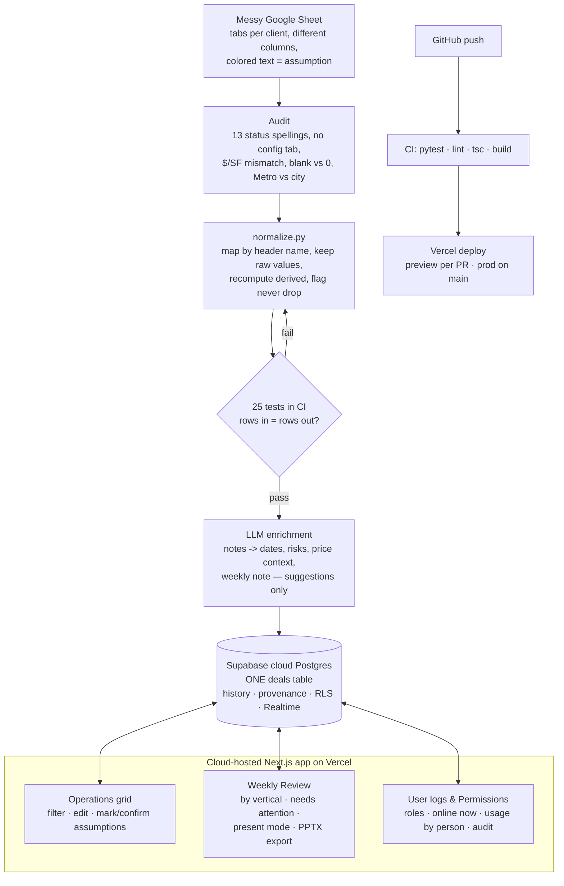

# Site Pipeline

## Reviewer quick start

- **Live app:** [atoms-website-three.vercel.app](https://atoms-website-three.vercel.app)
- **Health:** [atoms-website-three.vercel.app/api/health](https://atoms-website-three.vercel.app/api/health)
- **CI:** [](https://github.com/DiegoOrtizRuiz/Atoms-Website/actions/workflows/ci.yml)
- **Process log:** [PROCESS_LOG.md](./PROCESS_LOG.md)
- **Implementation plan and production checklist:** [PLAN.md](./PLAN.md)

Public sign-up is disabled. Use the shared demo password provided separately
in the submission email; it is intentionally not stored in this repository.

| Demo account | What it demonstrates |
| --- | --- |
| `admin@demo.test` | User scopes, activity/usage dashboards, data health, role preview, CSV export |
| `leadership@demo.test` | Weekly Review and snapshot saving without deal-edit permissions |
| `lead.food@demo.test` | Food-vertical editing and assumption confirmation |
| `analyst.a@demo.test` | Client A editing scope; other clients remain read-only |
| `viewer@demo.test` | Read-only Operations and Weekly Review |

### Try this in 2 minutes

1. Review the import report: 18 rows in and out, 13 status spellings, four
   flagged rows, and the caught $/SF discrepancy.
2. In Operations, filter deals, edit a permitted field, open a deal drawer,
   then confirm an assumption.
3. In Weekly Review, find “Seattle closes Nov 25,” start presentation mode,
   and export the PPTX.
4. In Admin, inspect Online now and usage, then preview the Analyst role.
5. Finish with the architecture: one cloud database powers every view; CI
   tests the importer, and assumptions use an explicit confirmation workflow.

### Architecture



### Test commands

```bash
npm run lint
npm run typecheck
npm test
npm run build
python -m pytest -q scripts
```

## Developer notes

A Next.js 15 and Supabase application for S&P Real Estate acquisition
operations, weekly reviews, and team administration. Every product view uses
one cloud Postgres dataset.

## Getting started

Copy `.env.example` to `.env.local` and add the Supabase project values, then
run:

```bash
npm install
npm run dev
```

Open [http://localhost:3000](http://localhost:3000).

The app uses invite-only Supabase Auth. Public sign-up must remain disabled.
The `/api/health` endpoint reports application, database, deal-count, and build
information without exposing credentials.

## Validation

```bash
npm run lint
npm run typecheck
npm run build
```

After applying Supabase migrations, refresh generated schema types with:

```bash
npx supabase gen types typescript --project-id <project-ref> \
  > src/lib/database.types.ts
```

## Deployment

Deploy the `main` branch to Vercel and add the same environment variables used
locally. Place the Supabase project and Vercel functions in the same region when
possible. Configure the `APP_URL` GitHub Actions variable after the first
production deployment so the keepalive workflow can reach `/api/health`.

## Seed data

Place the source workbook at `data/src.xlsx`, install the Python requirements,
normalize it, and seed Supabase:

```bash
python -m pip install -r scripts/requirements.txt
python scripts/normalize.py data/src.xlsx out
npm run seed
```

The seed command prefers the project `.venv` Python executable, then falls
back to `python3`. This avoids relying on a system `python` command.

Set `NEXT_PUBLIC_SUPABASE_URL`, `SUPABASE_SERVICE_ROLE_KEY`, and `DEMO_PASSWORD`
in `.env.local` before running the seed (shell values also work). The script
creates confirmed invite-only users and replaces only rows tagged as generated
seed activity, so rerunning it is safe.

## Optional LLM note enrichment

Set `LLM_PROVIDER`, `LLM_MODEL`, and the matching provider API key in
`.env.local`, then run:

```bash
.venv/bin/python scripts/llm_enrich.py
.venv/bin/python scripts/eval_llm.py
```

Enrichment writes only `notes_extracted` and `weekly_note` plus
`llm_suggested` provenance. Source fields are preserved and calls are cached in
`out/llm_cache.json`. Review the generated data before rerunning `npm run seed`.

For implementation phases, assumptions, and data decisions, see
[`PLAN.md`](./PLAN.md) and [`PROCESS_LOG.md`](./PROCESS_LOG.md).
